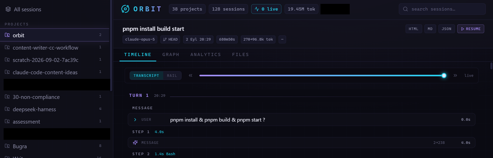
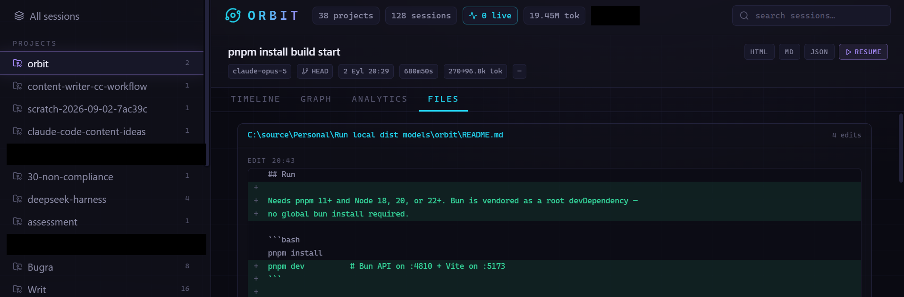
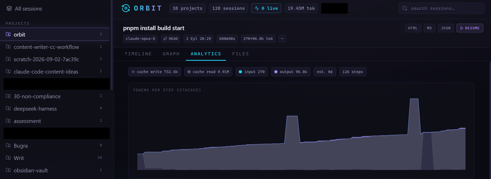
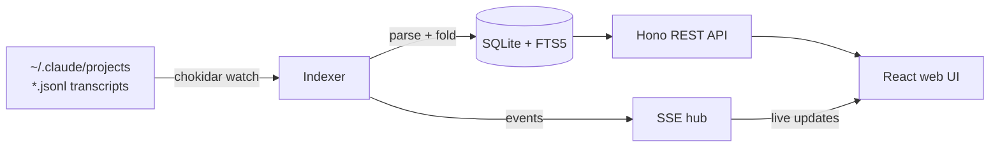

<div align="center">

# ◤ Orbit

**Claude Code sessions, replayed as trajectories.**

A local-first trajectory viewer for Claude Code. Indexes your session transcripts, folds them into turns → steps → tool calls, and renders them in a dark-neon web UI. Live, searchable, and 100% yours.

<p>
  
  
  
  
  
  
</p>

**Single machine · read-only over `~/.claude` · no cloud, no telemetry, no network calls.**

</div>

---

## Why Orbit

Claude Code already writes a perfect log: every session, every tool call, every token lands in `~/.claude/projects/**/*.jsonl`. What's missing is a way to *watch* those runs, to scrub through a two-hour agentic session, see which subagents it spawned, what each tool cost, and where it went wrong.

Orbit is that viewer. Its trajectory model (turns, steps, cells with own-duration times, token columns, tool-call pairing) is inspired by the trajectory view of the DeepSeek coding harness (DSH), adapted to Claude Code's transcript format.

## Features

| | |
|---|---|
| 🕰 **Trajectory timeline** | Turns → steps → cells (user / message / tool) with real durations, token columns and group histograms (`2m22s Bash`). Transcript ⇄ tool-rail toggle, plus a **scrubbing playhead** for time travel. |
| 🕸 **Agent graph** | Main session + every spawned agent, reconstructed from task notifications *and* subagent transcripts, with status, tools, tokens and durations. |
| ⚡ **Live tailing** | Watch a running session update in real time (watcher → reindex → SSE → browser, no refresh). |
| 📊 **Analytics** | Stacked per-step token chart + cumulative cost curve, with configurable model pricing. |
| 📝 **Diff view** | Every file touched by the session, rendered as red/green hunks from Edit/MultiEdit/Write calls. |
| 🔎 **Ctrl+K search** | FTS5 full-text search across *every* session; Enter opens the session and jumps to the matching line. |
| 📤 **Export & resume** | Self-contained HTML, Markdown or raw JSON export; one click resumes the session via `claude --resume`. |

## Screenshots

| Session browser | Trajectory timeline |
|---|---|
|  |  |

| Diff view | Analytics |
|---|---|
|  |  |

## Quickstart

Prerequisites: **pnpm 11+** and **Node 18, 20 or 22+** (Bun is installed automatically as a dev dependency).

```bash
git clone <your-repo-url> orbit
cd orbit
pnpm install
pnpm build                          # bundles the web app → apps/web/dist
pnpm --filter @orbit/server start   # http://localhost:4810
```

The server serves `apps/web/dist` as static files, so `pnpm build` must run first. There is no root `start` script, hence the `--filter`. If `pnpm install` fails on bun's postinstall, see [Troubleshooting](#troubleshooting).

Or hack on it:

```bash
pnpm dev            # server :4810 + Vite dev server :5173 (proxies /api)
pnpm typecheck      # tsc --noEmit across every package
```

While developing, open **http://localhost:5173**. Vite serves the UI with HMR and proxies `/api` to the server. Port `:4810` only ever serves the last built `dist`, so it looks stale (or blank before the first build) during `pnpm dev`.

On first start, Orbit indexes every transcript under `~/.claude/projects` (a few hundred sessions take ~15s), then watches the folder for changes.

### macOS app (DMG)

```bash
pnpm install --ignore-scripts
./scripts/build-dmg.sh              # → release/Orbit-<version>-arm64.dmg
ARCH=x64 ./scripts/build-dmg.sh     # Intel build
```

The DMG holds `Orbit.app`: a single compiled server binary plus the built UI. Launching it starts the server on `:4810` and opens your browser; the index lives in `~/Library/Application Support/Orbit`, logs in `~/Library/Logs/Orbit.log`. The app is ad-hoc signed, not notarized, so on first launch right-click → **Open** (or `xattr -dr com.apple.quarantine /Applications/Orbit.app`).

### Configuration (env vars)

| Variable | Default | Purpose |
|---|---|---|
| `PORT` | `4810` | API/UI port |
| `ORBIT_DATA_DIR` | `<repo>/data` | SQLite index location (resolved from the server source, not the CWD) |
| `ORBIT_CLAUDE_DIR` | `~/.claude/projects` | transcript root (useful for testing) |
| `ORBIT_WEB_DIST` | `apps/web/dist` | built UI directory to serve |

### Troubleshooting

**`pnpm install` fails with `Your package manager doesn't seem to support bun`**: bun's postinstall tries to `rename()` its platform binary out of pnpm's content-addressable store, which pnpm doesn't allow. Install once with `pnpm install --ignore-scripts`; the real binary links in from `@oven/bun-<platform>` on its own.

**`ERR_PNPM_EPERM` on Windows**: a previous server is still running and holding `bun.exe` open. Backgrounded dev servers outlive their shell, so strays accumulate:

```powershell
tasklist /FI "IMAGENAME eq bun.exe"   # find them
taskkill /PID <pid> /F                # then re-run install
```

## How it works



1. **Parse**: every JSONL line is read defensively (the format is undocumented and shifts between Claude Code versions; unknown rows degrade, never crash).
2. **Fold**: rows become a canonical trajectory of turns → groups → cells, with tool call/result pairing, own-duration times and token columns.
3. **Index**: sessions, rows, tool calls and searchable text land in SQLite (FTS5); incremental work is keyed on `(path, mtime, size)`.
4. **Serve**: a Hono API (REST + SSE) feeds the React UI; the indexer publishes `session-updated` events for live tailing.

## Repo layout

```
apps/server            Bun + Hono indexer, SQLite, REST + SSE API
apps/web               React 19 + Vite + Tailwind, the dark-neon UI
packages/trajectory    shared parser, model, fold and pricing
data/orbit.db          SQLite index (generated, gitignored)
SPEC.md                full design doc, incl. DSH-alignment notes
```

## Privacy

Orbit never leaves your machine: it reads `~/.claude` read-only, serves only localhost, uses system fonts (no CDN assets), and ships no telemetry. Your transcripts stay yours.

## Roadmap

- [ ] Annotations: human notes on tool-call groups (schema is ready)
- [ ] Waterfall timing view of parallel tool execution
- [ ] Full-file reconstruction from `file-history-snapshot` rows
- [ ] Multi-machine/server mode for teams

## Caveats

Claude Code's JSONL format is internal and undocumented, and it can change between releases. Orbit records the CC version per session and its parser is built to degrade gracefully, but if a new release renders something oddly, [open an issue](../../issues).

## License

MIT. See [LICENSE](./LICENSE).
